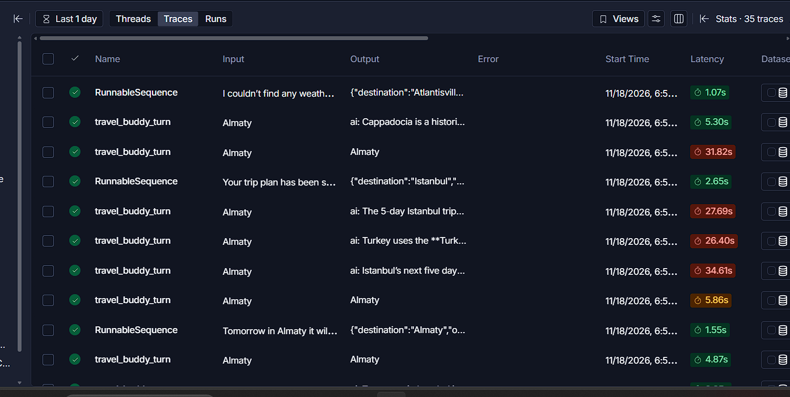
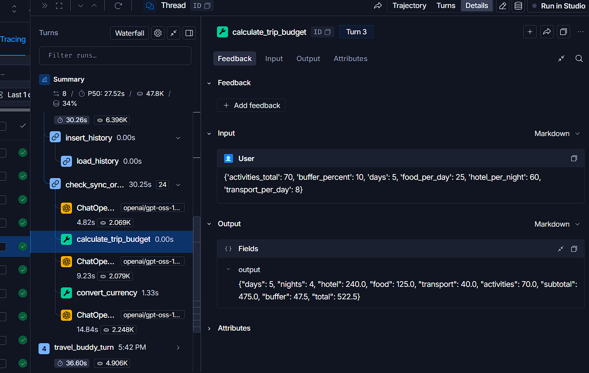
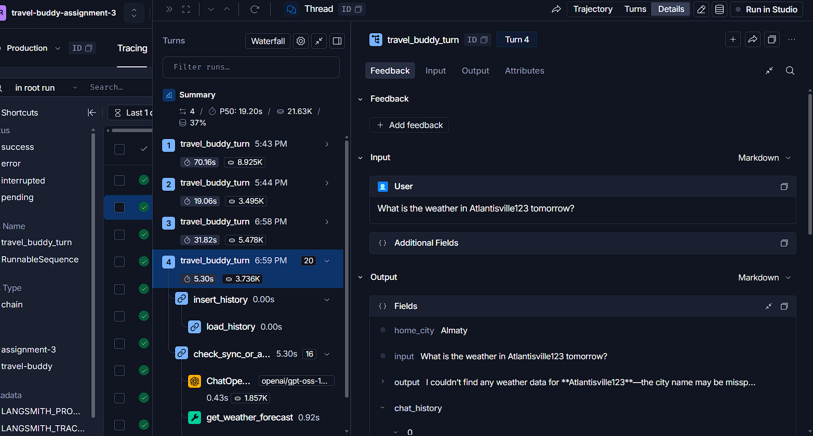

# Travel Buddy — a LangChain tool-calling agent

## What problem does it solve?

Planning a trip means opening 5 different sites: weather, exchange rates, country facts, a packing checklist and a calculator for the budget. **Travel Buddy** does all of this in one chat.

Example: *"Tomorrow in Almaty it will rain, so I don't recommend hiking. If you go, take a raincoat and good boots."* The agent really calls a weather API, reads the numbers and decides.

It is better than just asking ChatGPT because:
- the weather and exchange rates are **live data** from APIs, not guesses;
- the budget is calculated by **code** (exact math), not by the LLM;
- it **remembers the conversation**, so follow-up questions work ("and how much is that in KZT?");
- when an API fails, the agent says so honestly instead of making things up.

## Tools (7)

| Tool | Type | What it does |
|---|---|---|
| `get_weather_forecast(city, days)` | API (Open-Meteo) | Forecast for 1–7 days: temperature, rain, and an `outdoor_friendly` flag |
| `convert_currency(amount, from_currency, to_currency)` | API (Frankfurter, fallback open.er-api.com) | Live exchange rate and converted amount. Fallback is needed because Frankfurter (ECB) has no KZT |
| `get_country_info(country)` | API (ApiCountries, no key) | Capital, languages, currency, time zones, population |
| `get_place_summary(topic)` | API (Wikipedia) | Short summary of a city / landmark / park |
| `get_packing_list(temp_min_c, temp_max_c, rain_mm, activity)` | Own logic | Packing list based on weather and activity |
| `calculate_trip_budget(days, hotel_per_night, food_per_day, transport_per_day, activities_total, buffer_percent)` | Own logic | Exact trip cost with a safety buffer |
| `save_trip_plan(filename, content)` | Own logic (files) | Saves the plan to `saved_plans/<name>.txt` |

Every tool has a clear name, a docstring written for the LLM, typed arguments, a timeout, and returns `{"error": "..."}` instead of crashing (city not found, API down, bad input).

Note: `get_country_info` first used REST Countries v3.1, but that version was shut down (the new v5 needs an API key), so I switched to the free keyless ApiCountries API.

## LangChain parts

- **Prompts** (`prompts.py`): a long system prompt (role, rules, answer style) + a `ChatPromptTemplate` with a user template (`Traveler's home city (background info only, NOT the destination): {home_city}` / `Question: {input}`), a `chat_history` placeholder and an `agent_scratchpad` placeholder.
- **Agent**: `create_tool_calling_agent` + `AgentExecutor` (`agent.py`).
- **Memory**: `RunnableWithMessageHistory` with `InMemoryChatMessageHistory`, one history per `session_id`.
- **LCEL chains** (`agent.py`):
  - `CARD_PROMPT | llm.with_structured_output(TripCard)` → a Pydantic `TripCard` object (`/card` command).
  - `FOLLOWUP_PROMPT | llm | StrOutputParser()` → 3 follow-up question ideas (`/ideas` command).
- **LangSmith**: tracing turns on from `.env` (`LANGSMITH_TRACING=true`). Each turn has the run name `travel_buddy_turn` and tags.

## Model

Any OpenAI-compatible model through `ChatOpenAI(base_url, api_key, model)`.

**Model used: `openai/gpt-oss-120b` on Groq (free API).**

I first tried Gemini 2.5 Flash, but the Gemini free tier was blocked for my project (error 403). Then `llama-3.3-70b-versatile` was not available on my Groq account, so I used `openai/gpt-oss-120b`: it supports tool calling, it is fast, and it is free. `temperature=0` is used so tool choices are stable.

## How to run

**Python 3.12 is required.** LangChain 0.3.x does not work on Python 3.14.

```bash
py -3.12 -m venv .venv           # Mac/Linux: python3.12 -m venv .venv
source .venv/bin/activate        # Windows: .venv\Scripts\activate
pip install -r requirements.txt

cp .env.example .env             # Windows: copy .env.example .env
# open .env and put your LLM key and LangSmith key

python main.py                   # chat in the terminal
python run_examples.py           # runs 3 example conversations -> examples.md
```

Chat commands: `/card` (structured output), `/ideas` (follow-up questions), `/new` (clear memory), `/exit`.
Set `AGENT_VERBOSE=true` in `.env` to see every tool call in the terminal.

**Never upload `.env`.** It is already in `.gitignore`.

## Project structure

```
tools.py          7 @tool functions
prompts.py        system prompt, user template, chain prompts
agent.py          LLM, agent, memory, LCEL chains, Pydantic model
main.py           terminal chat
run_examples.py   runs example conversations
examples.md       output of run_examples.py
screenshots/      LangSmith screenshots
requirements.txt  dependencies (LangChain 0.3.x)
.env.example      template for keys (copy to .env)
```

## Example conversations

## Example 1: Weekend hike (weather tool + packing tool)

**User:** Tomorrow I want to hike near Almaty. Is it a good idea? What should I pack?

**Agent:** Tomorrow in Almaty it will be foggy, with temperatures from –0 °C to about 10 °C and no rain, so hiking is fine.

- Forecast: min –0 °C, max ≈ 10 °C, 0 mm rain, foggy, outdoor‑friendly.  
- Packing list for hiking: passport/ID, phone charger, power bank, warm winter jacket, hat, gloves, scarf, thermal underwear, hiking boots, backpack, first‑aid kit, snacks & water.

**Tip:** Layer your clothing so you can adjust quickly as it warms up while you ascend.

Structured card (`with_structured_output`):

```json
{
  "destination": "Almaty",
  "verdict": "Hiking is fine",
  "outdoor_friendly": true,
  "temp_range_c": "-0 to 10",
  "packing_list": [
    "passport/ID",
    "phone charger",
    "power bank",
    "warm winter jacket",
    "hat",
    "gloves",
    "scarf",
    "thermal underwear",
    "hiking boots",
    "backpack",
    "first-aid kit",
    "snacks & water"
  ],
  "estimated_total_cost": null
}
```

## Example 2: Multi-message trip to Istanbul (follow-ups use memory)

**User:** I am thinking about a 5-day trip to Istanbul. What is the weather like for the next days?

**Agent:** Istanbul’s next five days will be cool and mostly wet, so outdoor sightseeing may be limited.  

- **Wed 18 Nov:** 15.5‑18.8 °C, 0.5 mm rain, 85 % chance – not outdoor‑friendly.  
- **Thu 19 Nov:** 16.8‑20.3 °C, 0.1 mm rain, 23 % chance – mild, outdoor‑friendly.  
- **Fri 20 Nov:** 16.6‑21.5 °C, 14.5 mm rain, 53 % chance – heavy showers, not outdoor‑friendly.  
- **Sat 21 Nov:** 12.5‑17.0 °C, 11.3 mm rain, 38 % chance – cool and rainy.  
- **Sun 22 Nov:** 11.9‑15.7 °C, 5.9 mm rain, 36 % chance – chilly with showers.  

**Tip:** Pack a waterproof jacket, umbrella, and comfortable shoes, and schedule museums or cafés for the rainier days.

**User:** What currency do they use there and how much is 300 USD in it?

**Agent:** Turkey uses the **Turkish lira (TRY)**.  

- 300 USD ≈ **15,124 TRY** (using today’s rate of 1 USD ≈ 50.4 TRY).  

**Tip:** Credit cards are widely accepted, but keep some lira for small markets or tips.

**User:** OK. Hotel 60 USD per night, food 25 USD per day, transport 8 USD per day, museums 70 USD total. How much will the whole trip cost? Also give it in KZT.

**Agent:** The 5‑day Istanbul trip will cost about **522 USD** total (including a 10 % buffer).  

- Hotel (4 nights): 240 USD  
- Food (5 days): 125 USD  
- Transport (5 days): 40 USD  
- Museums & activities: 70 USD  
- Buffer (10 %): ≈ 48 USD  

**Converted to Kazakhstani tenge:** ≈ **232,170 KZT** (1 USD ≈ 444 KZT).  

**Tip:** Use a travel card with low foreign‑transaction fees to avoid extra conversion costs.

**User:** Great, save this plan to a file called istanbul_trip.

**Agent:** Your trip plan has been saved as **istanbul_trip.txt**. Let me know if you’d like anything else—packing suggestions, itinerary ideas, or travel tips!

Structured card (`with_structured_output`):

```json
{
  "destination": "Istanbul",
  "verdict": "Trip plan saved.",
  "outdoor_friendly": null,
  "temp_range_c": null,
  "packing_list": [],
  "estimated_total_cost": null
}
```

## Example 3: Place + country facts, and an error case

**User:** Tell me about Cappadocia and which country it is in, with the languages spoken there.

**Agent:** Cappadocia is a historic region in Central Anatolia, Turkey, known for its fairy‑chimney rock formations and ancient cave dwellings.  

- Country: **Turkey**  
- Official language(s): **Turkish**  

*Tip:* When visiting, bring comfortable shoes for walking on uneven terrain and a light jacket for cooler evenings.

**User:** What is the weather in Atlantisville123 tomorrow?

**Agent:** I couldn’t find any weather data for **Atlantisville123**—the city name may be misspelled or not recognized. Could you double‑check the spelling or let me know the correct destination?

Structured card (`with_structured_output`):

```json
{
  "destination": "Atlantisville123",
  "verdict": "Destination not recognized; verify spelling",
  "outdoor_friendly": null,
  "temp_range_c": null,
  "packing_list": [],
  "estimated_total_cost": null
}
```

## LangSmith traces

Tracing is on (`LANGSMITH_TRACING=true`). Every question is one `travel_buddy_turn` run.


All runs of the project, with green checkmarks.


The LLM calls `calculate_trip_budget` and `convert_currency` one after another. My code returns the exact total (522.5).


The weather tool returns "city not found" and the agent tells the user honestly.
